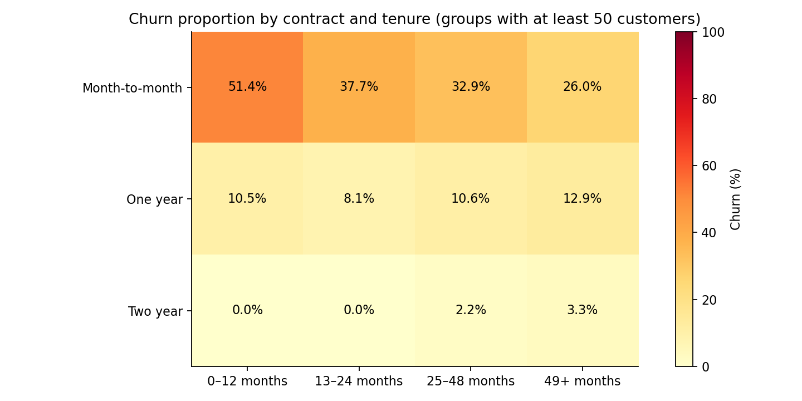

# Telco Customer Churn Analysis

**Question:** Which customer segments show higher churn in the IBM Telco sample, and what retention hypotheses should a business test?

A new portfolio case study using a dataset already in my project files, built with AI assistance. It demonstrates data quality handling, Python analysis, SQL CTEs and window functions, segment comparisons, uncertainty and practical recommendations.

## Findings

- **1,869 of 7,043 customers (26.5%)** are labelled churned.
- Contract type and tenure identify groups worth investigating. The comparisons are associations, not evidence that changing contracts prevents churn.
- **11 blank TotalCharges values** belong to customers with zero tenure. They remain missing and those customers stay in churn denominators.




## Worked example: contract comparison

**Question:** How do churn proportions differ by contract type?

```sql
SELECT Contract, COUNT(*) AS customers,
       SUM(churn_flag) AS churned,
       ROUND(100.0 * SUM(churn_flag) / COUNT(*), 1) AS churn_pct
FROM customers
GROUP BY Contract;
```

**Result:** month-to-month contracts have **42.7%** churn in this sample, compared with **2.8%** for two-year contracts. The denominator is customers within each contract group; the in-memory customers table is created by `src/analyze.py`.

**Interpretation:** investigate differences in tenure and customer mix before proposing an intervention. This does not prove that extending a contract reduces churn. [Counts and intervals](reports/contract_summary.csv).

## Reading the results

Start with [findings and the proposed pilot](reports/findings.md), then inspect [contract counts and intervals](reports/contract_summary.csv) before comparing rates. Use the [contract-and-tenure results](reports/contract_tenure_segments.csv) to examine how customer mix could affect the overall comparison.

A segment's churn denominator includes all customers in that segment, including the 11 customers with missing TotalCharges. These are sample churn proportions, not monthly churn rates. Before recommending an offer, specify a control group, a measurement window and contribution margin after offer costs. The current dataset cannot estimate the causal effect of that offer.

## Reproduce

From this repository's root, using Python 3.10 or later:

```bash
python -m venv .venv
source .venv/bin/activate
python -m pip install -r requirements.txt
python src/analyze.py
```

Windows: activate with `.venv\Scripts\activate`. The source CSV is included; no API keys are required. The script runs SQL in an in-memory SQLite database and rebuilds the CSV summaries, figures and findings in `reports/`.

## Methods and quality checks

1. Validate unique customer identifiers, churn labels, tenure and charges.
2. Convert blank TotalCharges to missing numeric values without dropping customers or imputing zero charges.
3. Define transparent tenure bands: 0–12, 13–24, 25–48 and 49+ months.
4. Use SQL grouping, a CTE and `DENSE_RANK()` to compare contract/tenure segments containing at least 50 customers.
5. Reconcile SQL counts to pandas and independently check the highest-rate segment.
6. Show illustrative 95% Wilson intervals on contract comparisons, with sample sizes.

## Explore the work

- [Python analysis](src/analyze.py)
- [SQL segment analysis](sql/segments.sql)
- [Findings and suggested retention pilot](reports/findings.md)
- [Segment results](reports/contract_tenure_segments.csv)
- [Contract summary and intervals](reports/contract_summary.csv)
- [Computed metrics](reports/metrics.json)
- [Input SHA-256 fingerprint](data/manifest.json)

## Source and limitations

Dataset: `WA_Fn-UseC_-Telco-Customer-Churn.csv`, the IBM Telco educational sample, also distributed in [IBM's Telco customer churn example](https://github.com/IBM/telco-customer-churn-on-icp4d). The included local copy contains 7,043 rows and is fingerprinted in the manifest. IBM and the original data creators retain their rights; no ownership of the dataset is claimed.

This is an educational sample, not a live company engagement. No timestamp, acquisition cohort, margin or intervention data is supplied. Churn proportions are cross-sectional and must not be presented as monthly churn hazards. The chart intervals are descriptive: the sample does not establish population representativeness, and confounding and multiple comparisons limit inference. No prediction accuracy, causal retention effect, forecast revenue loss or realized savings is claimed.

**Proposed next step:** investigate onboarding friction in high-churn segments, then evaluate a randomized retention pilot using incremental retention and contribution margin after offer costs.

## Automated validation

[Validation runs](https://github.com/Kelv-Ojo/telco-churn-analysis/actions/workflows/validate.yml) rebuild the analysis and check source fingerprints and fixed-snapshot totals. See [reproduction instructions and dependency pins](REPRODUCIBILITY.md). Python checks do not certify native Excel or Power BI behaviour.
